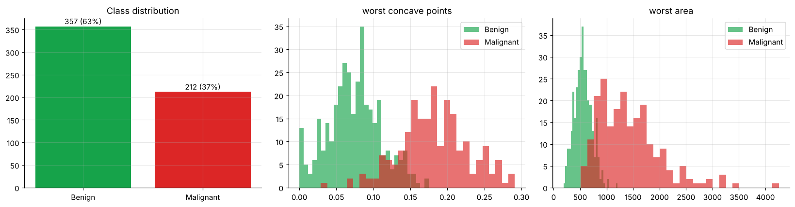
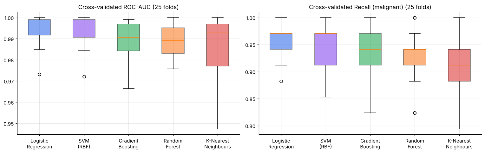
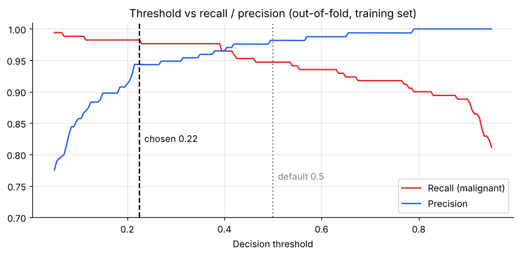
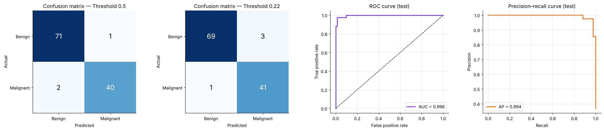
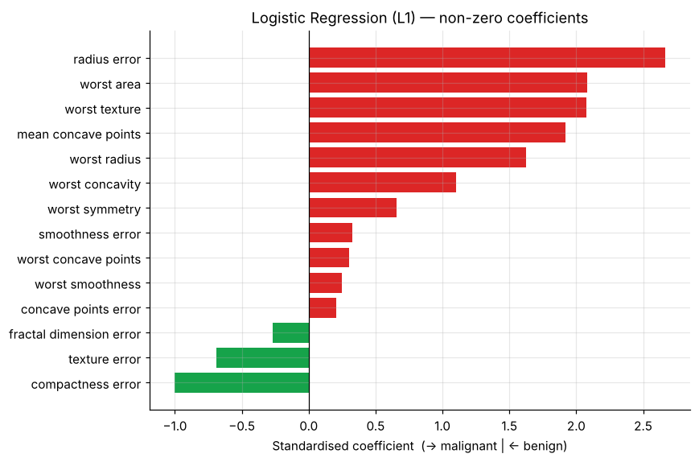
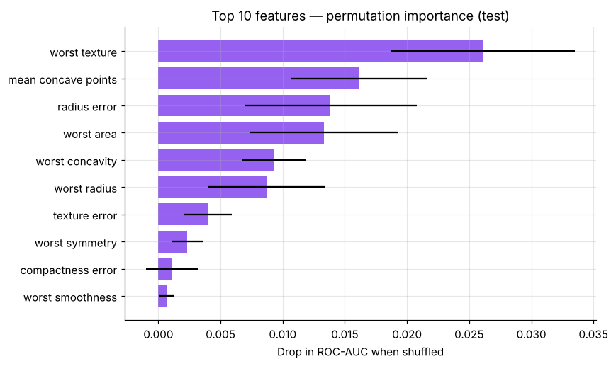
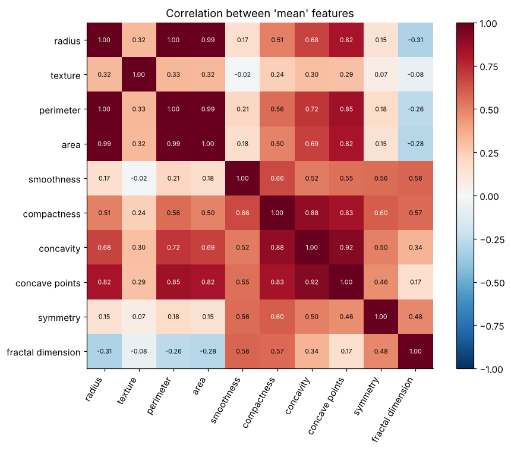
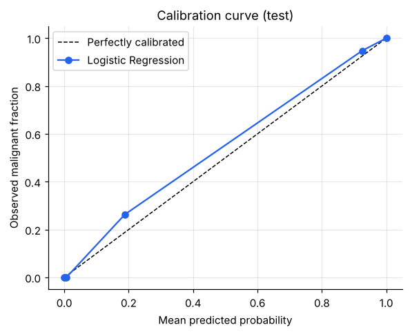

# 🩺 Breast Cancer Diagnosis — Classification with scikit-learn


Classifying breast tumours as **malignant** or **benign** from 30 cell-nucleus measurements (Wisconsin Diagnostic Breast Cancer dataset). The project compares five models, tunes them, and then **chooses a decision threshold that prioritises catching cancer**, because a missed malignant tumour costs far more than an extra follow-up test.

> Author: **Priyadharshini Sivasankar** · MSc Data Science · [Portfolio](https://priyadharshini2002-source.github.io/priyadharshini-data-science-portfolio/)

---

## 🏆 Results

**Cross-validation (5-fold × 5 repeats, training set only)**

| Model | ROC-AUC | Recall (malignant) | Precision | F1 | Accuracy |
|---|---|---|---|---|---|
| **Logistic Regression** | **0.995** | **0.953** | 0.979 | **0.965** | **0.975** |
| SVM (RBF) | 0.994 | 0.948 | 0.975 | 0.961 | 0.971 |
| Gradient Boosting | 0.989 | 0.926 | 0.952 | 0.938 | 0.954 |
| Random Forest | 0.989 | 0.927 | 0.956 | 0.940 | 0.956 |
| K-Nearest Neighbours | 0.985 | 0.916 | 0.988 | 0.950 | 0.964 |

**Held-out test set (114 patients, 42 malignant): tuned L1 Logistic Regression, test ROC-AUC 0.996**

| Decision threshold | Accuracy | Recall (malignant) | Precision | Specificity | Missed cancers | False alarms |
|---|---|---|---|---|---|---|
| Default 0.50 | 0.974 | 0.952 | 0.976 | 0.986 | 2 | 1 |
| **Recall-tuned 0.22** | 0.965 | **0.976** | 0.932 | 0.958 | **1** | 3 |

### Key findings
- 📈 **Simple beats complex here.** Regularised linear models (Logistic Regression and SVM) outperformed the tree ensembles on this small, well-structured dataset. Logistic Regression and the SVM were statistically tied (Wilcoxon p = 0.37, tuned CV ROC-AUC 0.996 for both), so the more **interpretable** model was chosen.
- 🎯 **The threshold is the clinical decision.** It was chosen from *out-of-fold* training predictions only, with no test leakage. Lowering it to 0.22 halved missed cancers (2 → 1) for 2 extra false alarms.
- 🔬 **Statistical testing (SciPy).** Mann–Whitney U tests with Bonferroni correction found that 26 of 30 features differ significantly between malignant and benign tumours.
- 🧩 **Built-in feature selection.** L1 regularisation kept only **14 of 30 features**, which reflects heavy multicollinearity (radius, perimeter and area have r > 0.99).
- 🔎 **Most important features (permutation importance):** worst texture, mean concave points, radius error, worst area and worst concavity, all of which describe nucleus size, texture and shape irregularity.

## 📊 Screenshots

### Exploratory analysis


### Model comparison (25 cross-validation folds)


### Choosing a recall-oriented threshold


### Test-set evaluation: confusion matrices, ROC and PR curves


### Interpretation: L1 coefficients and permutation importance
| | |
|---|---|
|  |  |

### Correlation and calibration
| | |
|---|---|
|  |  |

## ⚙️ Workflow
1. **EDA:** class balance (63% benign / 37% malignant), feature distributions and the correlation structure.
2. **Statistical tests:** Mann–Whitney U for each feature, with Bonferroni correction and rank-biserial effect sizes.
3. **Leak-free modelling:** a stratified 80/20 split, with every model inside a `Pipeline` (`StandardScaler` → classifier).
4. **Model comparison:** Logistic Regression, SVM, KNN, Random Forest and Gradient Boosting, compared with `RepeatedStratifiedKFold`, plus a paired Wilcoxon test between the top two models.
5. **Tuning:** `GridSearchCV` over regularisation strength and penalty (Logistic Regression), and C and γ (SVM).
6. **Threshold selection:** `cross_val_predict` out-of-fold probabilities, choosing the highest threshold that keeps recall ≥ 98%.
7. **Evaluation:** confusion matrix, ROC and PR curves, Brier score, calibration curve.
8. **Interpretation:** L1 coefficients and permutation importance.

## 🖥️ Streamlit app
`app.py` is an interactive decision-support demo. You pick a test patient or start from median values, adjust the 8 most influential measurements, and the app shows the predicted probability of malignancy, the decision at the recall-tuned threshold and each feature's contribution.

```bash
pip install -r requirements.txt
streamlit run app.py
```
To share it publicly, deploy the repo for free on [Streamlit Community Cloud](https://streamlit.io/cloud) with `app.py` as the entry point.

## ▶️ Run the notebook
```bash
pip install -r requirements.txt
jupyter notebook Breast_Cancer_Diagnosis_Classification.ipynb
```
No download is needed, because the dataset ships with scikit-learn (`load_breast_cancer`). The notebook also runs as-is in Google Colab.

## 📁 Structure
```
├── Breast_Cancer_Diagnosis_Classification.ipynb   # full analysis with outputs
├── app.py                                         # Streamlit demo
├── requirements.txt
├── figures/                                       # all plots used above
└── results/                                       # CV table, test results, statistical tests, importances
```

> ⚠️ This is an educational decision-support demo trained on a small single-centre dataset (569 samples). It is not a diagnostic tool.
